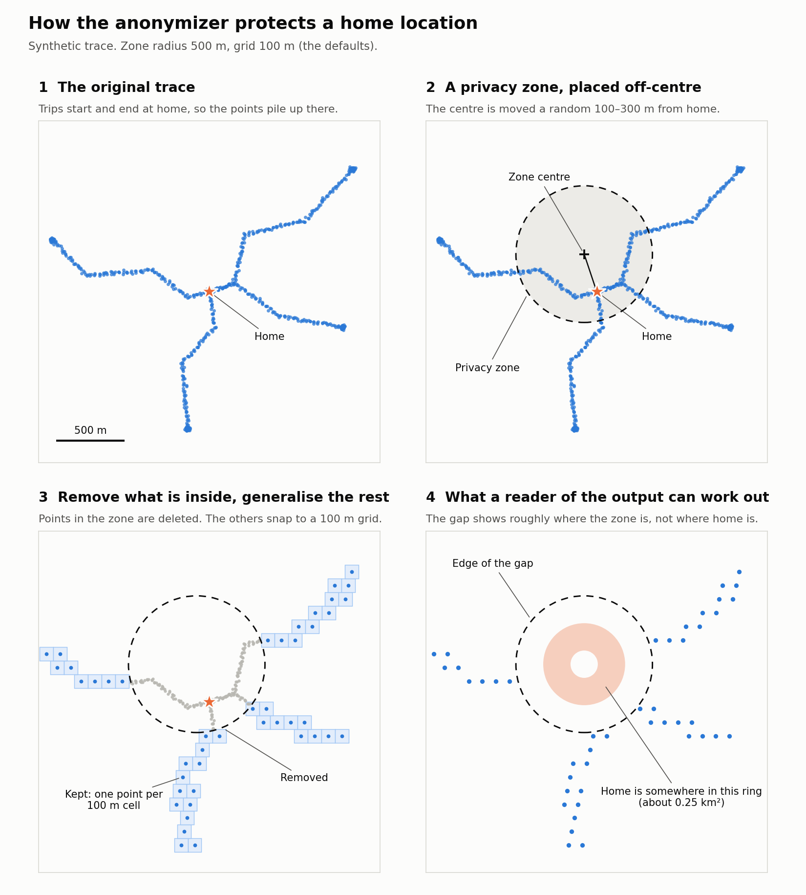

# Location Data Anonymizer

**Removes location data around home (and other protected places) from JSON location exports, and generalises the rest.**

Developed by **MobyX** in the context of the **SPINE project** for sharing location data in research.

## Overview

The tool takes a JSON export of personal location traces, mostly coming from Citizen app tracking data, and produces a copy that is safer to share:

1. **Finds the protected places** – home, by its `primaryActivityId`, plus any others you name (for example work).
2. **Draws a privacy zone around each one.** The zone centre is moved a random 20–60 % of the radius away from the place, so the gap left in the data is not centred on the home.
3. **Removes every coordinate inside a zone**, wherever it appears in the file – `locations`, `places`, `geoFence`, `userMobilities`, `predictions` or any other section.
4. **Snaps every remaining coordinate to a grid** (100 m cells by default).
5. **Audits the result** and writes nothing if a protected place can still be found in it.

Coordinates stay in their real geography, so the output can still be matched to roads, stops and lines.



The figure uses a synthetic trace and is drawn by running the anonymizer itself: `python examples/make_method_figure.py docs/method.png`.

## What this does and does not protect

Read this before sharing any output.

**It does**

- Remove the home coordinates and everything recorded within a few hundred metres of home.
- Stop the simple attacks: reading the home from `places`, averaging the home cluster, or taking the centre of the gap.
- Refuse to produce a file when the home cannot be identified or the audit fails.

**It does not**

- **Make the data anonymous in the GDPR sense.** A person's movement pattern is itself identifying – a handful of place-and-time points is usually enough to single someone out. Treat the output as pseudonymised personal data and share it under an agreement.
- **Hide the neighbourhood.** Someone studying the output can work out roughly where the zone is. They then know the home lies in a ring 0.2–0.6 × radius from its centre: 100–300 m with the default radius, about 0.25 km². In a dense city that covers many households; in a village it may be a few. **Increase `--radius` in sparse areas.**
- **Protect places you did not name.** A clinic, a friend's home or a place of worship is only blurred to the grid. Add its activity ID with `--protect` if it appears in `places`.
- **Touch timestamps.** Gaps in the trace show when the person was inside a zone.
- **Understand non-coordinate fields.** Addresses, place names, Wi-Fi names and coordinates packed into strings are copied through. Remove such fields with `--drop-key`.

Anonymize each person's data **once**. Two outputs with differently placed zones can be overlaid to narrow down the home; if you need to re-run, use `--key-file` so the zone lands in the same place every time.

## Installation

Requires Python 3.9 or higher. The anonymizer itself has no dependencies; `matplotlib` is only needed for `--viz`.

```bash
git clone https://github.com/acesonic7/location_anonymizer.git
cd location_anonymizer
pip install -e ".[viz]"
```

Or run the script directly without installing: `python location_anonymizer.py --help`.

## Usage

```bash
python location_anonymizer.py input.json output.json "19ac8d10-e85e-11ea-9c89-eb597145d8d6"
```

The third argument is the `primaryActivityId` that marks the home place in the `places` array.

Protect work as well, with a larger zone and coarser grid:

```bash
python location_anonymizer.py input.json output.json HOME_ID --protect WORK_ID --radius 0.8 --grid 250
```

Keep the records but move them to the displaced zone centre (useful when time spent at home matters, e.g. for activity-based models), and drop an address field:

```bash
python location_anonymizer.py input.json output.json HOME_ID --zone-mode snap --drop-key address
```

### Options

| Option | Description | Default |
|--------|-------------|---------|
| `--radius KM` | Privacy zone radius, 0.1–5.0 km | 0.5 |
| `--grid METRES` | Grid cell size for remaining coordinates, 10–5000 m; `0` turns it off | 100 |
| `--protect ID` | Another `primaryActivityId` to protect like home (repeatable) | – |
| `--zone-mode drop\|snap` | `drop` removes records inside a zone; `snap` keeps them at the displaced zone centre | `drop` |
| `--drop-key NAME` | Delete this field wherever it appears (repeatable) | – |
| `--key-file PATH` | Secret (≥ 16 bytes) that makes zone placement repeatable | random each run |
| `--viz PATH` | Save a before/after image **for your own checking – it shows the original data** | off |

The exit code is `0` on success and non-zero on any failure. On failure no output file is written.

### Example run

```bash
python examples/make_example.py example_input.json
python location_anonymizer.py example_input.json example_output.json HOME
```

```text
Protected places: 1 (zone radius 500 m, centre displaced 100-300 m)
Coordinates found: 743
  removed (inside a zone): 338
  blanked (inside a zone, could not remove the record): 0
  moved to the zone centre: 0
  generalised to a 100 m grid: 405
By section:
  locations: 740 found, 336 inside a zone
  places: 2 found, 1 inside a zone
  geoFence: 1 found, 1 inside a zone
Sections with no recognised coordinates (copied as they are - inspect before sharing): userMobilities, predictions
Audit passed: closest remaining coordinate to a protected place is 725 m away (before grid generalisation)
Anonymized data saved to example_output.json
```

Always read the "Sections with no recognised coordinates" line: those sections were copied unchanged.

## Input and output

The input is a JSON object with a `places` array that contains the home place:

```json
{
  "locations": [{"latitude": 40.0021, "longitude": 20.0004, "timestamp": 1700000000}],
  "places": [{"primaryActivityId": "…", "latitude": 40.0, "longitude": 20.0}],
  "geoFence": [],
  "userMobilities": [],
  "predictions": []
}
```

Coordinates are recognised anywhere in the document under `latitude`/`longitude`, `lat`/`lon`/`lng`/`long`, and prefixed forms such as `startLatitude`/`startLongitude`.

In the output:

- A record in a list whose own coordinates fall inside a zone is **removed** (in `drop` mode).
- Coordinates that cannot be removed with their record – nested objects, or prefixed pairs such as a trip's start point – are set to `null`.
- All other coordinates are replaced by the centre of their grid cell.
- Everything else is copied unchanged.

If the audit finds a protected location under field names it does not recognise, or in a `[lon, lat]` array, it stops and names the field so you can remove it with `--drop-key`.

## Docker

```bash
docker compose build
mkdir -p input output   # put your export in ./input
UID=$(id -u) GID=$(id -g) docker compose run --rm location-anonymizer \
  /app/input/input.json /app/output/output.json HOME_ID
```

## Changes from the first version

The first version shifted the whole trace by one random offset and added a little noise near home. That has been replaced, because:

- a constant shift keeps the exact shape of the trace, so it can be undone by lining the trace up with the road network or with any one known location;
- the home coordinates were still present, unchanged, in `places`;
- the noise near home averaged out over many points;
- a wrong home ID wrote the original data to the output file.

`--noise` is no longer used. `--no-viz` is now the default behaviour; pass `--viz PATH` to get an image.

## Development

```bash
pip install -e ".[dev]"
pytest
```

```
location_anonymizer/
├── location_anonymizer.py   # The anonymizer and its command line
├── tests/                   # Tests on synthetic data
├── examples/make_example.py # Writes a synthetic input file
├── examples/make_method_figure.py  # Draws docs/method.png
├── docs/method.png          # The figure above
├── Dockerfile, docker-compose.yml
└── pyproject.toml
```

Never commit real location exports. `.gitignore` excludes `*.json` and `*.png` for that reason; the synthetic `docs/method.png` is the one exception.

## About

### SPINE Project
This tool was developed as part of the SPINE (Smart Public transport Initiatives for climate-Neutral cities in Europe) project, which focuses on advancing public transport and sustainable transportation.

### MobyX
**MobyX** is a research team specializing in mobility data analytics and sustainable transportation solutions.

### License
This project is licensed under the MIT License.

## Contact

For questions, issues, or collaboration opportunities related to the SPINE project or location data anonymization, open an issue on GitHub or contact the MobyX development team.
